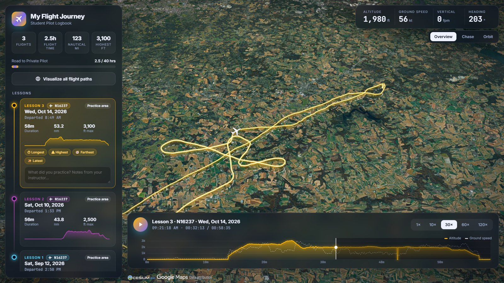

# Pilot Logbook

3D Logbook of my PPL flight training, built with [Cesium](https://cesium.com/).

- Each lesson card shows the aircraft (tail number) flown.
- Replays each lesson from ADS-B tracks stored as Cesium ion assets
- Cessna 172S 3D model with pitch/bank derived from the track
- Overview, chase, and orbit cameras with an altitude/speed chart
